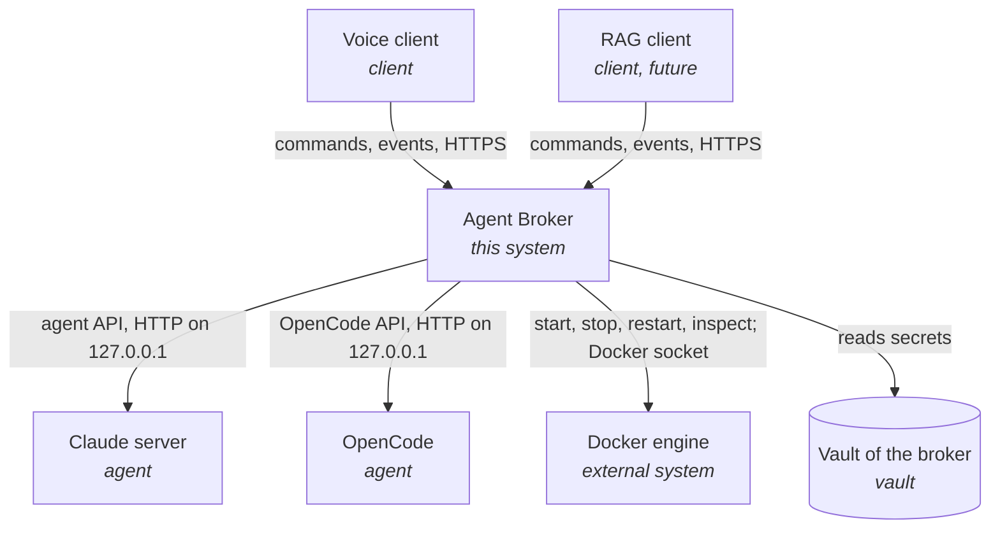
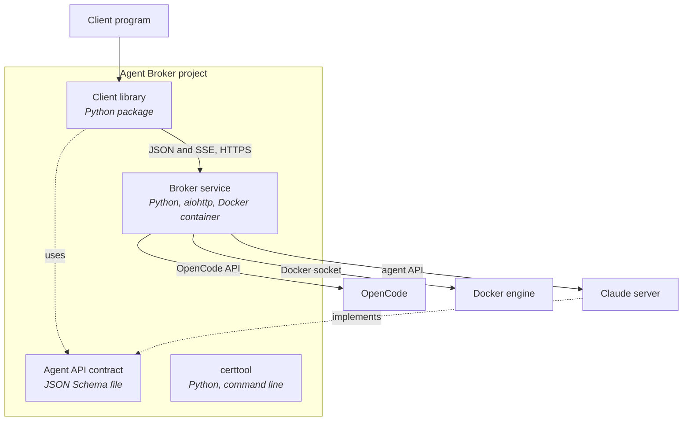
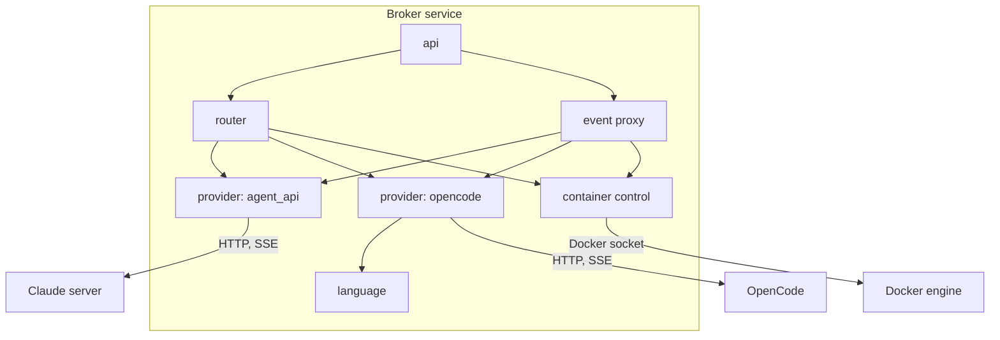
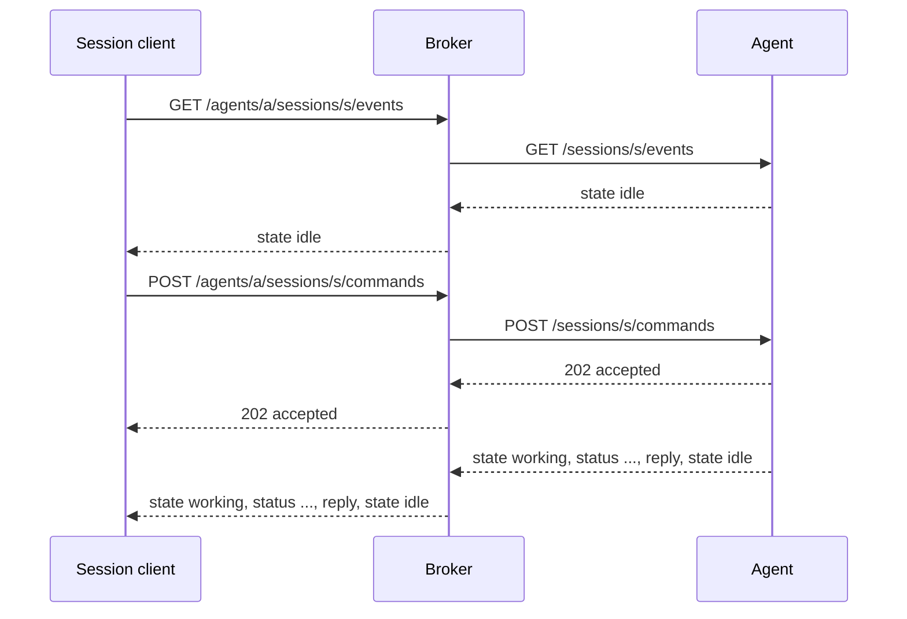
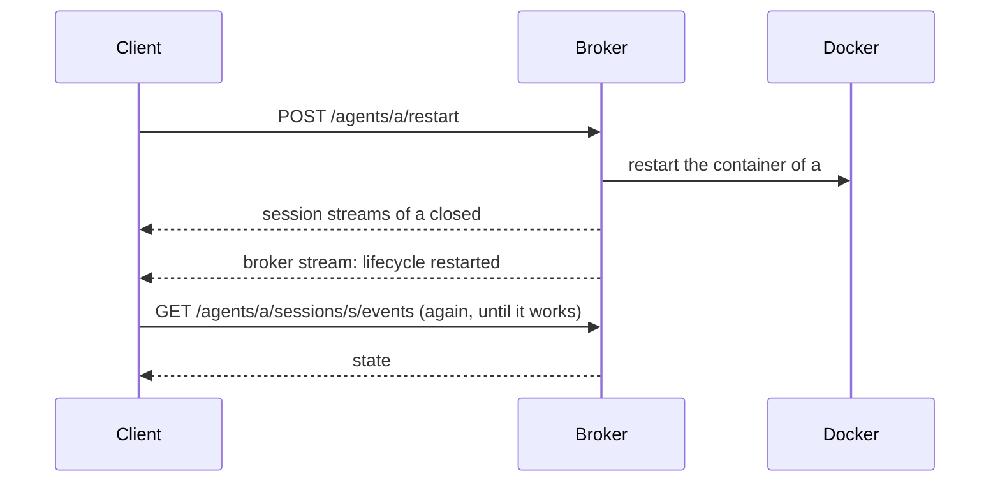

# Design — Agent Broker

This project uses the service variant of the SDD process. Section 6 defines the required behaviour of the service.

The work list is in [TODO.md](TODO.md).

## 1. Overview

The Agent Broker gives one API for several coding agents. A client selects an agent and a session in each call. The broker passes the call to the agent, passes the events back, and controls the container of each agent.

## 2. Architectural drivers

- Functional requirements: none. This project has no SRS.
- Quality attributes: none defined. This project has no QAS.
- Constraints:
  - The broker keeps no state on disk. A restart of the broker loses no data.
  - The broker is the only service with TLS and with a port on the LAN. Each agent listens on `127.0.0.1` only, with no TLS.
  - The broker controls the agent containers through the Docker socket.
  - Each client uses one agent and one session at a time. Several clients work in parallel.
  - OpenCode is not changed. The broker adapts to its API (version 2.2.7).
  - RAG, the model providers of OpenCode and the inside of each agent are out of scope.

## 3. System context (C4 level 1)

System boundary: the broker service, its client library and the agent API contract. The agents, Docker and the vault are outside.

- **Client:** a program that sends commands to an agent and reads the events. It uses the client library.
- **Claude server:** the agent for Claude Code. It implements the agent API of this project.
- **OpenCode:** an agent with its own API. The broker has an adapter for it.
- **Docker engine:** runs the agent containers.
- **Vault of the broker:** holds the secrets of the broker (section 8.4).

## 4. Containers (C4 level 2)

- **Broker service:** the HTTPS API, the routing to the agents, the event streams and the container control.
- **Client library:** the broker client and the session client. Each client project uses it from the submodule of this project.
- **Agent API contract:** `messages.schema.json` (section 8.2) and the operations of section 6.1.2. An agent that implements it needs no adapter.
- **certtool:** makes the key pair of the broker. It writes the key to the vault.

## 5. Components (C4 level 3)

### 5.1 Broker service

- **api:** TLS, HTTP basic authentication, validation of each message against the schema, error answers.
- **router:** finds the provider of the agent that the URL names.
- **provider:** the interface to one kind of agent. The configuration gives the provider of each agent.
  - **agent_api:** passes each call to an agent that implements the agent API.
  - **opencode:** translates each call and each event to and from the OpenCode API (section 6.2.1).
- **container control:** starts, stops, restarts and inspects the container of an agent.
- **event proxy:** opens one upstream stream for each client session stream. It keeps one upstream agent stream for each agent and merges them into the broker stream. It sends the heartbeat.
- **language:** detects the language of a reply text. Only the `opencode` provider uses it. An agent that implements the agent API detects the language itself.

### 5.2 Client library

- **broker client:** one connection to one broker with one client ID. It lists and controls the agents, reads the broker stream, and makes session clients. One process can hold several broker clients.
- **session client:** one session of one agent. It sends the commands and the interrupt, and reads the session stream.

## 6. Interfaces

### 6.1 Container interfaces

#### 6.1.1 Broker API

HTTPS on BROKER_HOST (`0.0.0.0`), port BROKER_PORT (38443). Each request needs HTTP basic authentication with the API login (section 8.4). All clients use the same login. Section 8.2 gives the schema of each message.

`{agent}` is the name of an agent from the configuration. `{id}` is a session ID that the agent made.

| Operation | Description |
| --- | --- |
| `GET /agents` | `AgentList`. For each agent: name, provider, container state, agent state, version. The broker asks Docker and the agent at each call. It does not answer from a cache. A disabled agent is not in the list, and each call for it gives `404`; the broker does not touch its container. An enabled agent with a provider that is not implemented is skipped, with a WARNING in the log. An agent that the broker cannot reach has the version `""`. |
| `POST /agents/{agent}/start` | Starts the container of the agent. `AgentResult`. |
| `POST /agents/{agent}/stop` | Stops the container. The broker closes each session stream of the agent. `AgentResult`. |
| `POST /agents/{agent}/restart` | Restarts the container. The broker closes each session stream of the agent. `AgentResult`. |
| `GET /agents/{agent}/config` | `ConfigValues`: all configuration values of the agent. Each agent has the keys `logging.levels.<component>` with the values `ERROR`, `WARNING`, `INFO` or `DEBUG`. The level of a component selects its `log` events on the broker stream. The other keys belong to the agent. |
| `GET /agents/{agent}/config/{key}` | `ConfigValue`: one value. Dotted key. |
| `PUT /agents/{agent}/config/{key}` | Body `ConfigSetRequest`. `ConfigSetResult` with `applied`: `now` or `at_restart`. |
| `GET /events` | Broker stream (SSE) for all agents. See "Streams". |
| `GET /agents/{agent}/models` | `ModelList`: the models of the agent and its DEFAULT_MODEL. A client uses DEFAULT_MODEL as its starting value. See "Session settings". |
| `GET /agents/{agent}/efforts` | `EffortList`: the efforts of the agent and its DEFAULT_EFFORT. See "Session settings". |
| `POST /agents/{agent}/sessions` | Body `SessionCreateRequest`: `client` (required), `workspace` (required), `model` (required), `effort` (optional), `tools` (optional), `force` (optional, default `false`). Creates a session. Answer `201` `Session`. `404` `workspace_not_found` if the folder does not exist and `force` is `false`. `400` `invalid_setting` for a model or an effort that the agent does not have. `400` `unsupported_tools` for a tool policy that the agent cannot apply. An agent can lose a session that has no command yet when the agent restarts. Its ID then gives `404`. |
| `PUT /agents/{agent}/sessions/{id}/settings` | Body `SessionSettingsRequest`: `model`, `effort`, or both. Changes the settings of this session only. Answer `Session`. `409` `busy` in the state `working`. `400` `invalid_setting` as for a new session. |
| `GET /agents/{agent}/sessions?client={client}` | `SessionList`: the sessions of the agent that have this client ID. `client` is required. The broker reads all sessions from the agent and filters them. |
| `GET /agents/{agent}/sessions/{id}` | `Session` with its current `state`. The broker reads it from the agent at each call. |
| `DELETE /agents/{agent}/sessions/{id}` | Deletes the session at the agent. The agent removes the stored chat of the session and closes the session stream. Answer `204` with no body. |
| `GET /agents/{agent}/sessions/{id}/events` | Session stream (SSE). See "Streams". |
| `POST /agents/{agent}/sessions/{id}/commands` | Body `CommandRequest`. Starts a command. A text that starts with `/` is a slash command of the agent. The agent replies to a slash command that it does not know with a text that says so. Answer `202` `CommandAccepted`: `accepted`, or `duplicate` for the ID of the last command of the session (runs nothing). `409` `busy` in the state `working`. In the state `stopped`, the agent tries the session again before it runs the command ("Failures"). |
| `POST /agents/{agent}/sessions/{id}/interrupt` | Stops the command that runs. The session stream gets `notice` `command_dropped` for it, then `state` `idle`. With no command that runs: no action and no start of resources. Answer `SessionResult` with the current state. |
| Errors | `ErrorResponse` with `400`, `401`, `404`, `409`, or `503` `agent_unavailable`. `503` `agent_unavailable` comes when the broker cannot reach the agent or the Docker engine, and when the broker stops. `404` also comes when the container of an agent does not exist. An error answer of an agent that is not an `ErrorResponse` gets the error value of its status. The broker waits AGENT_REQUEST_TIMEOUT (10 s) for an agent and DOCKER_CONTROL_TIMEOUT (55 s) for start, stop and restart; then `503`. |

**Session.** A session is a stored chat of one agent.

- A session is bound to one workspace folder for its whole life.
- A session carries the client ID that created it. The agent stores it. The broker stores nothing.
- The field `agent` of a session is the name of the agent in the configuration of the broker. The broker writes it.
- Any client can use any session ID. The client ID is not a security measure.
- A client stores the ID of each session that it uses.

**Session settings.** Each session has a model, an effort and a tool policy. The broker keeps none of them: the agent stores them with the session.

- `model` is an ID from `GET /models` of the agent. It is required for a new session. No setting of an agent or of the broker gives a model to a session.
- `effort` is a value from `GET /efforts`. A new session without it gets DEFAULT_EFFORT of the agent. An agent with no efforts gives the list `["auto"]`.
- DEFAULT_MODEL and DEFAULT_EFFORT are values of each agent. A client uses them as its starting values. The client keeps its own choice. The agent design defines the values.
- `PUT .../settings` changes the model or the effort of one session. The next command uses the new values. No other session changes.
- `tools` is a `ToolPolicy`: `allow` (a list of tool names, or `null` for each tool of the agent) and `deny` (a list of tool names). A tool in `deny` is never available. Without `tools`: `allow` `null`, `deny` empty, which is each tool of the agent.
- The tool policy is fixed for the life of the session. It cannot change.
- Tool names and model IDs are the names of the agent. The broker does not translate them.
- An agent that cannot apply a policy refuses it with `400` `unsupported_tools`. It never runs a session with more tools than the policy allows.
- `Session` returns `model`, `effort` and `tools`.

**Workspace.** `workspace` is a path relative to the workspace root of the agent.

- `/x`, `./x` and `x` mean the folder `x` under the root. `/` and `.` mean the root.
- The workspace is the root or one folder directly under it. The agent rejects a nested path, a symbolic link and a path that resolves outside the root (`400`).
- With `force`, the agent creates a folder that does not exist.
- `Session` returns `workspace` (the relative form, e.g. `x`) and `workspace_path` (the path that the agent uses).
- No part translates paths in a chat. The chat uses the paths of the agent.

**Session state.** The field `state` of a session:

| State | Meaning | A new command |
| --- | --- | --- |
| `idle` | No command runs. | Runs. |
| `working` | A command runs. | `409` `busy`. |
| `stopped` | The agent cannot continue the session after a failure. | The agent tries the session again, then runs the command. |

A stream of a `stopped` session gets `state` `stopped` and starts nothing.

**Failures.** Each agent shows a failure to the clients in the same way:

- A command that ends with an error gives `notice` `command_failed` with its `command_id` and the error text. Then `state` `idle`.
- A failure of the agent while a command runs gives `notice` `command_failed` for that command. Then the agent tries to continue the session: `state` `idle` if it can, `stopped` if it cannot.
- A command that ends with no result gives `notice` `command_dropped`: an interrupt, or a command that the agent drops.
- `notice` `lifecycle` on a session stream tells only about the session: it started, was resumed, has a new chat, crashed, or stopped.
- When the upstream session stream ends in the state `working`, e.g. the container of the agent ends, the broker sends `notice` `command_failed` for the open command. Then it closes the client stream. The client connects again.
- The broker stream gives the end of a container (`notice` `lifecycle`). While the agent is not reachable, each call for it gives `503` `agent_unavailable`.

**Events.**

| Event | Meaning |
| --- | --- |
| `state` | The state of the session ("Session state"). |
| `status` | A short text for a person about the current activity of the agent, e.g. the tool that it uses. A client can speak it. |
| `reply` | The answer to a command, with its `command_id` and its `language`. |
| `notice` | A failure or a change of the session ("Failures"). |
| `log` | A log line of the agent, with its component and level. |

**Streams.** Both streams are SSE. The field `event` holds the type. The field `data` holds the JSON body. Events have no `id`.

| Stream | Events | Fields in each event |
| --- | --- | --- |
| Session stream | `state`, `status`, `reply`, `notice` with the kinds `command_failed`, `command_dropped` and `lifecycle` (of the session) | `agent`, `session` |
| Broker stream | `notice` with the kind `lifecycle` (container started, restarted, ended; agent reachable, not reachable), `log` (log lines of an agent) | `agent` |

- A container gives one lifecycle event for each end, with the exit code in the text. Docker sends the same event for a stop and for a crash. The broker does not remember which stops it started itself, so it does not tell the two apart.
- The first event of a session stream is the current `state` of the session.
- Then the agent sends the last reply again, if it is not older than REPLY_REPLAY (600 s) and no stream got it.
- After that, a stream carries only live events.
- Several streams can read one session. Each one gets each event.
- When the broker loses the upstream stream of a session, it closes the client stream. The client connects again.
- Each client stream has a send queue of STREAM_QUEUE_LIMIT (100) events. When an event comes and the queue is full, the broker treats the link as broken. It closes the client stream and its upstream stream.
- The broker drops no event silently. It writes the number of lost events of a closed stream to its log.
- The broker does not pass an event of an agent that does not agree with the schema. It writes a WARNING to its log.

**Heartbeat.** The broker writes an SSE comment line on each stream after HEARTBEAT_INTERVAL (15 s) with no data. A client that gets no data for HEARTBEAT_TIMEOUT (45 s) closes the connection and connects again. If a heartbeat write fails, the broker closes the upstream stream of that client.

#### 6.1.2 Agent API

An agent implements this API to work with the provider `agent_api`. HTTP on `127.0.0.1`, with no TLS and no authentication. The messages are the same as in section 6.1.1.

| Operation | Description |
| --- | --- |
| `GET /status` | `AgentStatus`: uptime, version, number of open sessions. |
| `GET /config`, `GET /config/{key}`, `PUT /config/{key}` | As in section 6.1.1. |
| `GET /events` | Agent stream (SSE): `notice` with the kind `lifecycle`, and `log`. |
| `GET /models`, `GET /efforts` | As `GET /agents/{agent}/models` and `GET /agents/{agent}/efforts`. |
| `POST /sessions` | As `POST /agents/{agent}/sessions`. |
| `PUT /sessions/{id}/settings` | As `PUT /agents/{agent}/sessions/{id}/settings`. |
| `GET /sessions` | `SessionList` with all sessions of the agent. No filter. A session that another tool made has the client `null`. |
| `GET /sessions/{id}`, `DELETE /sessions/{id}` | As in section 6.1.1. |
| `GET /sessions/{id}/events` | Session stream, as in section 6.1.1. |
| `POST /sessions/{id}/commands`, `POST /sessions/{id}/interrupt` | As in section 6.1.1. |

Rules for an agent:

- The agent follows the session states and the failures of section 6.1.1.
- The client library has the contract suite of this API (`agent_broker_client.contract`). An agent runs it against its own code. The tests of the broker run it against their fake agent.
- The agent stores the client ID and the workspace with the session.
- The session ID does not change during the life of a session. This applies also when the agent starts a new chat inside the session.
- `DELETE /sessions/{id}` removes the stored chat of the session.
- The agent detects the language of each reply. `language` is required in each `reply` event.
- The agent sends no heartbeat. The connection to the broker is local.
- The agent does not send the field `agent` in an event. The broker writes the name of the agent into each event that it passes to a client. In the agent API, the field is optional (section 8.2).
- The agent has no operation that restarts it. The broker restarts its container.
- An open session stream tells the agent that a client uses the session. The agent decides when it opens and closes its resources for the session.

#### 6.1.3 Client library

| Part | Interface |
| --- | --- |
| Broker client | Made with the broker URL, the login and a client ID. Lists the agents. Starts, stops and restarts an agent. Reads and sets the configuration of an agent. Gives the events of the broker stream. Lists the models and the efforts of an agent. Lists the sessions of its client ID. Creates a session (workspace, model, optional effort, optional tool policy, `force`) and returns a session client. Changes the settings of a session. Returns a session client for a known session ID. Deletes a session. |
| Session client | Sends a command. Sends an interrupt. Changes the model or the effort of its session. Gives the events of the session stream. Closes. |

- A session client holds one session stream. It connects again after a heartbeat timeout or a closed stream, until it is closed.
- The session client and the broker client wait RECONNECT_INTERVAL (5 s) between two tries to connect.
- To change the session, a program makes a new session client. It closes the old one when the old one expects no more events, or after a timeout of the program.
- A broker client holds one broker stream, with the same reconnect rule.
- Each stream holds a maximum of STREAM_QUEUE_LIMIT (100) events that the program did not read. At this limit, the library treats the link as broken and drops the connection. It keeps the waiting events.
- After a drop for the limit, the library connects again by the reconnect rule. It connects only after the program has read the waiting events.
- The library waits AGENT_CONTROL_TIMEOUT (60 s) for the answer to start, stop and restart of an agent. Each other request waits REQUEST_TIMEOUT (15 s).

#### 6.1.4 Command line

| Operation | Description |
| --- | --- |
| `run.sh cert` | Makes a new key pair with the names of CERT_NAMES. Writes the certificate to `tls/server.crt` and the key to the vault. |
| `run.sh test` | Installs the test dependencies in a venv and runs the tests. |
| `update.sh [--dry-run] [--no-up] [--override FILE]` | Host: pulls the current branch, builds the image, runs `prepare.sh` and runs `docker compose up -d`. `--dry-run` prints the steps and changes nothing. `--no-up` skips the start. |
| `prepare.sh [--dry-run] [--override FILE]` | Host: makes the configuration folder and the deploy folder with `compose.yaml` and `.env`. With `--override FILE`: the override and the folders of the vault. |

### 6.2 Component interfaces

| Component | Interface | Used by |
| --- | --- | --- |
| api | The routes of section 6.1.1, the check of each message | clients |
| router | The provider and the container of an agent name | api |
| provider | Each operation of section 6.1.1 for one kind of agent: `agent_api` passes it to the agent API (section 6.1.2), `opencode` translates it (section 6.2.1) | router, event proxy |
| container control | Start, stop, restart and inspect a container | router, event proxy |
| event proxy | The upstream streams, the client streams, the broker stream | api |
| language | The language of a reply text | provider `opencode` |

#### 6.2.1 Provider `opencode`

The provider `opencode` implements the operations of section 6.1.1 with the HTTP API of OpenCode 2.2.7 (`/api/...`, HTTP basic authentication, username `opencode`, password: the OpenCode password of section 8.4). The routes and the shapes come from the OpenAPI document of OpenCode (`/openapi.json`) and from tests on the target host.

| Broker operation | OpenCode |
| --- | --- |
| List the models | `GET /api/model`: each model as `providerID/id`, e.g. `cloudflare/@cf/openai/gpt-oss-20b`, with its name. DEFAULT_MODEL: `GET /api/model/default`. |
| List the efforts | No call. The list is `["auto"]`, and DEFAULT_EFFORT is `auto`. Another effort gives `400` `invalid_setting`. |
| Create a session | `POST /api/session` with `location.directory` (OPENCODE_WORKSPACE_ROOT (`/home/opencode/workspace`) and the workspace), `model` (`{id, providerID}`), `permissions` (the rules of the tool policy, "Tools") and `metadata` (`client`, `workspace`, `tools`). The session uses the default agent of OpenCode. A model that is not in the list gives `400` `invalid_setting`. |
| Change the settings | `POST /api/session/{id}/model` with the new model. `409` `busy` in the state `working`. |
| List sessions | `GET /api/session`, all pages (`cursor.next`), without the child sessions. The client ID is `metadata.client`. |
| Read a session | `GET /api/session/{id}`. The state is `working` while `time.busy` is later than `time.idle`, else `idle`. |
| Delete a session | `DELETE /api/session/{id}`. |
| Session stream | The `state` from `GET /api/session/{id}`; the reply replay from `GET /api/session/{id}/context`; then the live events of `GET /api/event` with the `sessionID` of the session. |
| Send a command | `POST /api/session/{id}/prompt` with `id`: `msg_` and the hex digits of the command ID, and `text`. The same ID again gives `409` at OpenCode: the provider answers `duplicate`. `409` `busy` in the state `working`. |
| Interrupt | `POST /api/session/{id}/interrupt`. |
| Agent stream | `GET /api/event`. OpenCode sends no lifecycle and no log events: the stream gives no event. |
| Start, stop, restart | Docker only. OpenCode has no such call. |
| Configuration | No key: `GET /config` gives an empty list; a key gives `404`. |

| OpenCode event (`/api/event`) | Broker event |
| --- | --- |
| `session.inbox.delivered` | none: `inboxID` gives the command ID of the turn |
| `session.execution.started` | `state` `working` |
| `session.step.started`, `session.tool.called` | `status` |
| `session.text.ended` | none: the last text of the turn |
| `session.execution.succeeded` | `reply` with the last text of the turn and the detected language; then `state` `idle` |
| `session.execution.failed` | `notice` `command_failed` with the error; then `state` `idle` |
| `session.execution.interrupted` | `notice` `command_dropped`; then `state` `idle` |

- The provider keeps no state. The settings of a session stay in the session at OpenCode.
- `GET /api/experimental/session/{id}/log?follow=true` gives no live events in OpenCode 2.2.7. The provider does not use it.
- A turn can end with no text, e.g. a model that gives only reasoning: the reply is empty.
- The language detection uses the languages of LANGUAGES (`en`, `pl`) and LANGUAGE_THRESHOLD (0.70). Below the threshold, the reply has the language `en`.
- The folder of the workspaces is OPENCODE_WORKSPACE_ROOT (`/home/opencode/workspace`). OpenCode accepts a session in a folder that does not exist, but its prompts then give `404`. So the provider checks the folder in the container of OpenCode through Docker (`test -d`): a missing folder gives `404` `workspace_not_found`; with `force`, the provider makes it first (`mkdir -p`), as the user of the container.
- The provider follows the session states and the failures of section 6.1.1. It gives no `stopped`: OpenCode continues each session.

**Tools.** OpenCode keeps permission rules for each session. The last rule that matches wins, and the rules of a session come after the rules of the agent. The provider makes the rules of a tool policy:

| Tool policy | Rules |
| --- | --- |
| `allow` `null` | none |
| `allow` with names | deny each action, then allow each name |
| `deny` with names | then deny each name |

- Each session also denies `read` of `*.env` and `*.env.*`. OpenCode asks a person before such a read, and a broker session has no person.
- The tool names are the action names of OpenCode, e.g. `webfetch`, `websearch`, `shell`, `edit`.
- Each tool policy works: the provider gives no `unsupported_tools`.
- Verified on the target host: a session that denies each action calls no tool; a session that allows `webfetch` and `websearch` calls the web search.

## 7. Key flows

### 7.1 Command to an agent

### 7.2 Restart of an agent

### 7.3 Change of session in a client

1. The program makes a new session client for the new session.
2. The new session client opens its stream and gets the `state`.
3. The old session client stays until it expects no more events, or until the timeout of the program.
4. The program closes the old session client. The broker closes the upstream stream.

## 8. Data model

### 8.1 State

- The broker has no state on disk.
- In memory: the open client streams, the upstream stream of each one, and one agent stream for each agent.

### 8.2 Message schemas

`messages.schema.json` in this repository is the contract (JSON Schema, draft 2020-12). It comes from the schema of the earlier API of the Claude server. Each client and each agent reads this file from the submodule. No project keeps a copy.

Changes against the schema of the earlier API of the Claude server:

| Message | Change |
| --- | --- |
| `SessionCreateRequest` | New: `client`, `workspace`, `force`. |
| `Session` | New: `id`, `agent`, `client` (string or null), `workspace`, `workspace_path`, `state`, `title` (string or null), `created_at`, `last_modified`. |
| `SessionList` | New: a list of `Session`. |
| `AgentList`, `AgentResult`, `AgentStatus` | New. `AgentList`: `name`, `provider`, `container_state`, `agent_state` and `version` of each agent. `AgentResult`: `agent`, `container_state`. `AgentStatus`: `uptime_s`, `version`, `open_sessions`. `AgentStatus` replaces `ServerStatus`. |
| `StateEvent`, `StatusEvent`, `ReplyEvent`, `NoticeEvent` | New required fields `agent` and `session` in the events of a session stream. |
| `NoticeEvent`, `LogEvent` of the broker stream | New required field `agent`. |
| `AgentApiStateEvent`, `AgentApiStatusEvent`, `AgentApiReplyEvent`, `AgentApiNoticeEvent`, `AgentApiLogEvent` | New: the events of the agent API. The field `agent` is optional. |
| `ErrorResponse` | New error values: `workspace_not_found`, `agent_unavailable`. |
| `RestartResult`, `ServerStatus` | Removed. |
| `SessionCreateRequest`, `Session` | New: `model` (required), `effort`, `tools` (`ToolPolicy`). `Session` requires all three. |
| `ToolPolicy`, `SessionSettingsRequest`, `ModelList`, `EffortList` | New: see "Session settings" in section 6.1.1. |
| `ErrorResponse` | New error values: `invalid_setting`, `unsupported_tools`. |
| `CommandRequest`, `CommandAccepted`, `Config*`, `SessionResult`, `SessionState`, `Language` | No change. |

- `created_at` and `last_modified` are ISO 8601 date-time strings in UTC (`format: date-time`).
- `container_state` is a Docker state: `running`, `exited`, `restarting`, `paused`, `created` or `dead`. It is `missing` when no container exists. The Docker state `removing` is `exited`.
- `agent_state` is `ok` or `unreachable`.
- The events have two definitions. An agent sends the events of the agent API (`AgentApi...Event`). The broker adds `agent` and sends the events of the broker API (`StateEvent` etc.). Each event of the broker API refers to its event of the agent API and requires `agent`.

### 8.3 Configuration

`config/config.yaml` holds the default values. It holds no secrets.

| Key | Content |
| --- | --- |
| `server.host`, `server.port` | BROKER_HOST, BROKER_PORT |
| `log.level` | LOG_LEVEL |
| `agents.<name>.enabled` | `true` or `false`. The broker serves only an enabled agent. |
| `agents.<name>.provider` | `agent_api` or `opencode` |
| `agents.<name>.url` | The local URL of the agent |
| `agents.<name>.container` | The name of the container of the agent |
| `agents.<name>.workspace_root` | The provider `opencode`: OPENCODE_WORKSPACE_ROOT |
| `streams.heartbeat_interval_s`, `streams.heartbeat_timeout_s` | HEARTBEAT_INTERVAL, HEARTBEAT_TIMEOUT |
| `streams.queue_limit` | STREAM_QUEUE_LIMIT of the broker |
| `docker.socket` | DOCKER_SOCKET |
| `language.languages`, `language.threshold` | LANGUAGES, LANGUAGE_THRESHOLD |
| `cert.file` | The certificate file |
| `credentials.vault`, `credentials.secrets` | The name of the vault (empty: no vault), and the vault entry and the environment variable of each secret |

The client library reads no key of this file. RECONNECT_INTERVAL (5 s), AGENT_CONTROL_TIMEOUT (60 s) and its own STREAM_QUEUE_LIMIT (100) are values of the client library (section 12).

`config/config.yaml` of the component client holds the defaults of `cert.file`, `cert.names` (CERT_NAMES) and `cert.validity_years` (CERT_VALIDITY). certtool reads it. The file of `run.sh cert --config FILE` replaces the values of a host. Keep it in the deployment project of the host.

The file holds all settings of the two supported agents, `claude` and `opencode`. A local file (`local.yaml` of `${XDG_CONFIG_HOME:-$HOME/.config}/gustaw/agent_broker/`) can change each value of these agents, also `enabled`. It cannot add another agent.

Default agents:

| Name | Enabled | Provider | URL | Container |
| --- | --- | --- | --- | --- |
| `claude` | yes | `agent_api` | `http://127.0.0.1:38444` | `claude_code_server` |
| `opencode` | no (a host enables it in `local.yaml`) | `opencode` | `http://127.0.0.1:4096` | `opencode` |

### 8.4 Secrets

The broker service gets its secrets with `secrets_proxy`, a copy of the reference code of maya-agent-kit. The source is selected one time, at the start:

- `credentials.vault` is set: each secret comes from the vault of `credentials.vault`. There is no fallback.
- `credentials.vault` is empty: each secret comes from its environment variable, or from the file of `<variable>_FILE`.
  The service removes these variables from its environment.

| Secret | Vault entry and key | Environment variable | Used by |
| --- | --- | --- | --- |
| TLS private key (PEM) | `Agent Broker TLS 01`, `private_key` | `AGENT_BROKER_TLS_PRIVATE_KEY` (use `_FILE`: an env file holds one line only) | Broker service |
| API login | `Agent Broker API 01`, `username` and `password` | `AGENT_BROKER_API_USERNAME`, `AGENT_BROKER_API_PASSWORD` | Broker service |
| OpenCode password | `OpenCode API token`, `password` | `AGENT_BROKER_OPENCODE_PASSWORD` | Provider `opencode` |

- `certtool` makes the key of `Agent Broker TLS 01` directly in this vault.
- A client project keeps its own copy of the login `Agent Broker API 01` in its own vault.

## 9. Deployment

- The target environment: Ubuntu Server 26.04 LTS, Docker Engine with the rootful daemon.
- The broker runs as one Docker container on the target host, with the host network.
- The image `agent_broker:<commit>` and `agent_broker:latest` is built from `ubuntu:26.04` with Python 3.14 in a venv. It holds the committed code of the project (both components) in `/opt/gustaw/agent_broker`. It holds no secret, no vault and no part of maya-agent-kit.
- A host with a vault mounts the vault at `/opt/gustaw/<vault>` and the vault tool at `/opt/gustaw/maya/tools/auth` with `compose.override.yaml`. The paths of `dependencies.txt` (`../vault-agent_broker`, `../maya`) find them.
- The container runs as the user of `prepare.sh` on the host (`HOST_UID`, `HOST_GID`), not as root. `compose.yaml` adds the group of the Docker socket (`group_add`, variable `DOCKER_GID`). HOME is the `tmpfs` `/home/gustaw/agent_broker` of that user. It holds the scratch folder of the TLS key.
- The project has its own clone on the host, with the dependencies next to it or inside it. `update.sh` works on the repository that it is in:
  1. It checks that HEAD is on a branch and that the clone has no local changes. It pulls the current branch with `git pull --ff-only`. It does not switch the branch, so the clone can stay on a release branch.
  2. It builds the image from the committed code (`git archive` of the project), with the commit ID, date and subject as build arguments.
  3. It runs `prepare.sh`: the configuration folder, the deploy folder `${HOME}/containers/agent_broker/` with `compose.yaml` and `.env`. With `--override FILE`, `prepare.sh` finds the vault and the vault tool with the lookup of the rule submodule-dependencies.
  4. It runs `docker compose up -d` in the deploy folder: the container is made again from the new image. `--no-up` skips this step.
- A restart of the container does not update the code.
- `compose.yaml` of this project defines the container `agent_broker`, with the host network and the restart policy `unless-stopped`. It holds no value of a host.
- Mounts: the Docker socket; the configuration folder of the host user `${XDG_CONFIG_HOME:-$HOME/.config}/gustaw/agent_broker/`, read-only, at `~/.config/gustaw/agent_broker/` of the container, for the optional `local.yaml`, the certificate and the secrets. With a vault, `compose.override.yaml` adds the vault, read-write (the vault tool writes its access log), and the vault tool, read-only.
- The secrets without a vault come from `agent_broker.env` of the configuration folder (`env_file`, optional).
- `prepare.sh` writes the variables of `compose.yaml` into `.env` of the deploy folder. The operator values are in `config.env` of the configuration folder: AGENT_BROKER_DOCKER_SOCKET. A variable of the environment replaces a value of `config.env`.
- With a vault, the clone key of the host clone must open the vault without a terminal.
- The certificate is self-signed: ECDSA P-256, valid CERT_VALIDITY (10 years), names CERT_NAMES. This repository holds no certificate. The deployment project of the host keeps it and deploys it as `server.crt` into the configuration folder (`cert.file`). Each client gives the file of its host.

| Dependency | Container | Use |
| --- | --- | --- |
| Python 3.14, aiohttp | Broker service, client library | HTTP server, HTTP client, SSE |
| Docker Engine API | Broker service | Container control: direct HTTP calls on the Docker socket with aiohttp, no Docker library |
| lingua-language-detector | Broker service | Language of the replies of OpenCode |
| maya-agent-kit (vault tool) | Broker service with a vault, certtool | Secrets |

## 10. Architecture decisions

The decisions are in [ADL.md](ADL.md). This project has no ADR.

## 11. Open issues

- `update.sh` pulls the project. `prepare.sh --override` only finds the vault and the vault tool. A newer project can need a newer vault tool. The owner pulls the dependencies by hand. Open: `update.sh` pulls them too, or they become submodules of the project.
- **MISSING:** the configuration values of OpenCode that `GET` and `PUT /agents/opencode/config` give.
- Not verified: OpenCode runs a prompt with a repeated ID only one time.
- Not verified: the working directory of the OpenCode container on the target host is its workspace folder.
- The session log route of OpenCode is marked experimental.
- Not verified: the broker with a real agent behind it. The build, the start, the login, the certificate and the event stream are verified in the target environment.
- The clone key of the host must be a plain file that the user of the container can read, because the container has no OS keyring. Verified in the target environment with such a key. Not verified: a key that the OS keyring protects.

## 12. Default values

| Name | Default | Unit | Configuration key | Meaning |
| --- | --- | --- | --- | --- |
| BROKER_HOST | `0.0.0.0` | — | `server.host` | Address that the broker listens on |
| BROKER_PORT | 38443 | — | `server.port` | Port of the broker |
| LOG_LEVEL | `INFO` | — | `log.level` | Lowest level of the log lines of the broker: `ERROR`, `WARNING`, `INFO` or `DEBUG` |
| HEARTBEAT_INTERVAL | 15 | s | `streams.heartbeat_interval_s` | Idle time before a heartbeat line |
| AGENT_REQUEST_TIMEOUT | 10 | s | — | Wait for an answer of an agent |
| DOCKER_CONTROL_TIMEOUT | 55 | s | — | Wait for start, stop and restart of a container |
| REQUEST_TIMEOUT | 15 | s | — | Wait of the client library for an answer of the broker, except start, stop and restart |
| HEARTBEAT_TIMEOUT | 45 | s | `streams.heartbeat_timeout_s` | Time with no data after which a client connects again |
| REPLY_REPLAY | 600 | s | agent configuration | Maximum age of a reply that a new stream gets again |
| RECONNECT_INTERVAL | 5 | s | — (value of the client library) | Wait of the session client and the broker client between two tries to connect |
| STREAM_QUEUE_LIMIT | 100 | events | `streams.queue_limit` (broker); value of the client library | Waiting events of a stream at which the side that notices it drops the connection |
| AGENT_CONTROL_TIMEOUT | 60 | s | — (value of the client library) | Wait of the client library for the answer to start, stop and restart of an agent |
| DOCKER_SOCKET | `/var/run/docker.sock` | — | `docker.socket` | Path of the Docker socket |
| LANGUAGES | `en`, `pl` | — | `language.languages` | Languages of the detection in the provider `opencode` |
| LANGUAGE_THRESHOLD | 0.70 | — | `language.threshold` | Minimum confidence to change the language |
| CERT_NAMES | `localhost`, `127.0.0.1`, and the names and addresses of the target host | — | `cert.names` (component client) | Names in the certificate |
| CERT_VALIDITY | 10 | years | `cert.validity_years` (component client) | Validity of the certificate |
| DEFAULT_MODEL | each agent defines it | — | — | Model in `ModelList`: the starting value of a client |
| OPENCODE_WORKSPACE_ROOT | `/home/opencode/workspace` | — | `agents.<name>.workspace_root` | The folder of the workspaces in the container of OpenCode |
| DEFAULT_EFFORT | each agent defines it; `auto` for the provider `opencode` | — | — | Effort of a new session that gives none |
