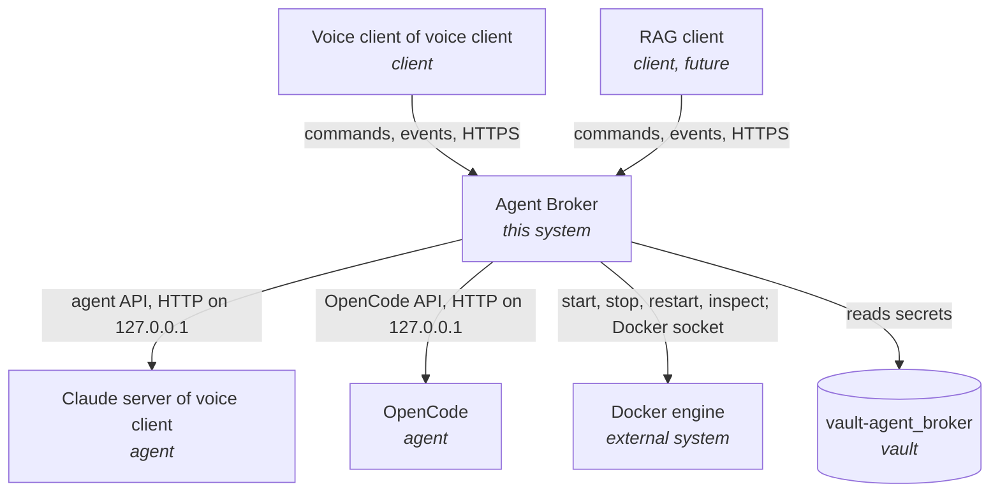
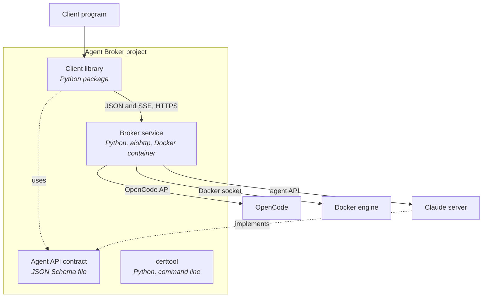
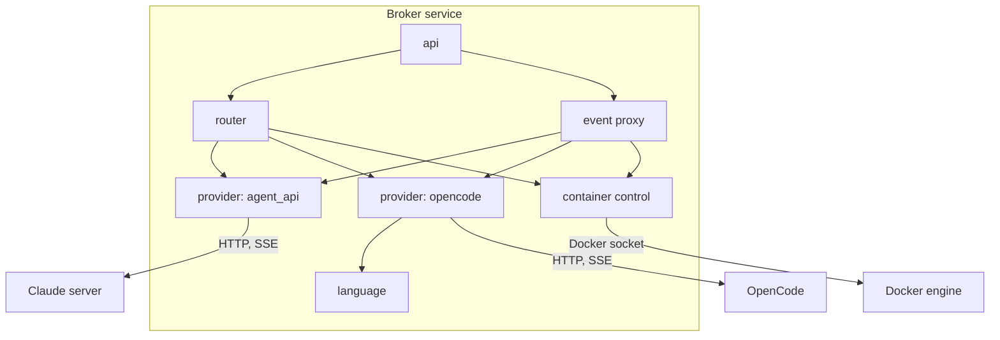
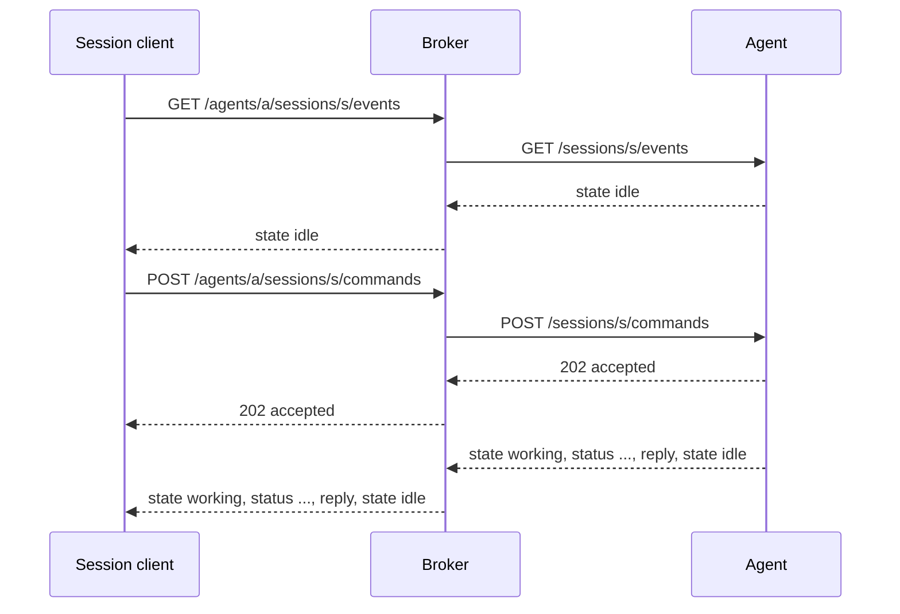
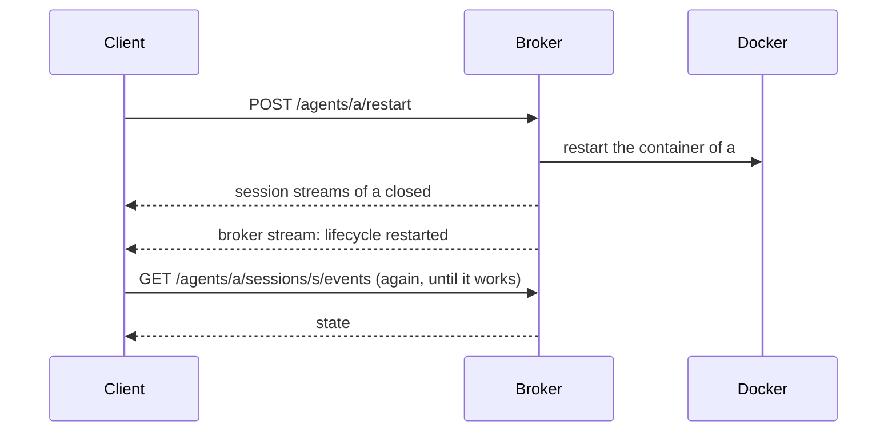

# Design — Agent Broker

This project uses the service variant of the SDD process. Section 6 defines the required behaviour of the service.

Not implemented: this document is the design before the implementation. [ADR-20261115-service_split](the voice client repository/blob/main/sdd/adr/ADR-20261115-service_split.md) of voice client proposes the change that uses this service.

## 1. Overview

The Agent Broker gives one API for several coding agents. A client selects an agent and a session in each call. The broker passes the call to the agent, passes the events back, and controls the container of each agent.

## 2. Architectural drivers

- Functional requirements: section 6. This project has no SRS.
- Quality attributes: none defined. This project has no QAS.
- Constraints:
  - The broker keeps no state on disk. A restart of the broker loses no data.
  - The broker is the only service with TLS and with a port on the LAN. Each agent listens on `127.0.0.1` only, with no TLS.
  - The broker controls the agent containers through the Docker socket.
  - Each client uses one agent and one session at a time. Several clients work in parallel.
  - OpenCode is not changed. The broker adapts to its API (version 2.2.7).
  - RAG, the model providers of OpenCode and the inside of each agent are out of scope.

## 3. System context (C4 level 1)

System boundary: the broker service, its client library and the agent API contract. The agents, Docker and the vault are outside.

- **Client:** a program that sends commands to an agent and reads the events. It uses the client library.
- **Claude server:** the agent of voice client. It implements the agent API of this project.
- **OpenCode:** an agent with its own API. The broker has an adapter for it.
- **Docker engine:** runs the agent containers.
- **vault-agent_broker:** holds the secrets of the broker (section 8.4).

## 4. Containers (C4 level 2)

- **Broker service:** the HTTPS API, the routing to the agents, the event streams and the container control.
- **Client library:** the broker client and the session client. Each client project uses it from the submodule of this project.
- **Agent API contract:** `messages.schema.json` (section 8.2) and the operations of section 6.2. An agent that implements it needs no adapter.
- **certtool:** makes the key pair of the broker. It writes the key to the vault.

## 5. Components (C4 level 3)

### 5.1 Broker service

- **api:** TLS, HTTP basic authentication, validation of each message against the schema, error answers.
- **router:** finds the provider of the agent that the URL names.
- **provider:** the interface to one kind of agent. The configuration gives the provider of each agent.
  - **agent_api:** passes each call to an agent that implements the agent API.
  - **opencode:** translates each call and each event to and from the OpenCode API (section 6.3).
- **container control:** starts, stops, restarts and inspects the container of an agent.
- **event proxy:** opens one upstream stream for each client session stream. It keeps one upstream agent stream for each agent and merges them into the broker stream. It sends the heartbeat.
- **language:** detects the language of a reply text. Only the `opencode` provider uses it. An agent that implements the agent API detects the language itself.

### 5.2 Client library

- **broker client:** one connection to one broker with one client ID. It lists and controls the agents, reads the broker stream, and makes session clients. One process can hold several broker clients.
- **session client:** one session of one agent. It sends the commands and the interrupt, and reads the session stream.

## 6. Interfaces

### 6.1 Broker API

HTTPS on BROKER_HOST (`0.0.0.0`), port BROKER_PORT (38443). Each request needs HTTP basic authentication with the login of the vault entry `Agent Broker API 01`. All clients use the same login. Section 8.2 gives the schema of each message.

`{agent}` is the name of an agent from the configuration. `{id}` is a session ID that the agent made.

| Operation | Description |
| --- | --- |
| `GET /agents` | `AgentList`. For each agent: name, provider, container state, agent state, version. The broker asks Docker and the agent at each call. It does not answer from a cache. |
| `POST /agents/{agent}/start` | Starts the container of the agent. `AgentResult`. |
| `POST /agents/{agent}/stop` | Stops the container. The broker closes each session stream of the agent. `AgentResult`. |
| `POST /agents/{agent}/restart` | Restarts the container. The broker closes each session stream of the agent. `AgentResult`. |
| `GET /agents/{agent}/config` | `ConfigValues`: all configuration values of the agent. |
| `GET /agents/{agent}/config/{key}` | `ConfigValue`: one value. Dotted key. |
| `PUT /agents/{agent}/config/{key}` | Body `ConfigSetRequest`. `ConfigSetResult` with `applied`: `now` or `at_restart`. |
| `GET /events` | Broker stream (SSE) for all agents. See "Streams". |
| `POST /agents/{agent}/sessions` | Body `SessionCreateRequest`: `client` (required), `workspace` (required), `force` (optional, default `false`). Creates a session. Answer `201` `Session`. `404` `workspace_not_found` if the folder does not exist and `force` is `false`. |
| `GET /agents/{agent}/sessions?client={client}` | `SessionList`: the sessions of the agent that have this client ID. `client` is required. The broker reads all sessions from the agent and filters them. |
| `GET /agents/{agent}/sessions/{id}` | `Session` with its current `state`. The broker reads it from the agent at each call. |
| `DELETE /agents/{agent}/sessions/{id}` | Deletes the session at the agent. The agent closes the session stream. |
| `GET /agents/{agent}/sessions/{id}/events` | Session stream (SSE). See "Streams". |
| `POST /agents/{agent}/sessions/{id}/commands` | Body `CommandRequest`. Starts a command. Answer `202` `CommandAccepted`: `accepted`, or `duplicate` for the ID of the last command of the session (runs nothing). `409` `busy` if a command runs. |
| `POST /agents/{agent}/sessions/{id}/interrupt` | Stops the command that runs. `SessionResult`. |
| Errors | `ErrorResponse` with `400`, `401`, `404`, `409`, or `503` `agent_unavailable` when the broker cannot reach the agent. |

**Session.** A session is a stored chat of one agent.

- A session is bound to one workspace folder for its whole life.
- A session carries the client ID that created it. The agent stores it. The broker stores nothing.
- Any client can use any session ID. The client ID is not a security measure.
- A client stores the ID of each session that it uses.

**Workspace.** `workspace` is a path relative to the workspace root of the agent.

- `/x`, `./x` and `x` mean the folder `x` under the root. `/` and `.` mean the root.
- The agent rejects a path that resolves outside the root (`400`).
- With `force`, the agent creates a folder that does not exist.
- `Session` returns `workspace` (the relative form, e.g. `x`) and `workspace_path` (the path that the agent uses).
- No part translates paths in a chat. The chat uses the paths of the agent.

**Streams.** Both streams are SSE. The field `event` holds the type. The field `data` holds the JSON body. Events have no `id`.

| Stream | Events | Fields in each event |
| --- | --- | --- |
| Session stream | `state`, `status`, `reply`, `notice` with the kinds `command_failed`, `command_dropped` and `lifecycle` (of the session) | `agent`, `session` |
| Broker stream | `notice` with the kind `lifecycle` (container started, stopped, restarted, crashed; agent reachable, not reachable), `log` (log lines of an agent) | `agent` |

- The first event of a session stream is the current `state` of the session.
- Then the agent sends the last reply again, if it is not older than REPLY_REPLAY (600 s) and no stream got it.
- After that, a stream carries only live events.
- Several streams can read one session. Each one gets each event.
- When the broker loses the upstream stream of a session, it closes the client stream. The client connects again.
- The broker never drops an event of a stream. If a client reads too slowly, the broker closes the stream.

**Heartbeat.** The broker writes an SSE comment line on each stream after HEARTBEAT_INTERVAL (15 s) with no data. A client that gets no data for HEARTBEAT_TIMEOUT (45 s) closes the connection and connects again. If a heartbeat write fails, the broker closes the upstream stream of that client.

### 6.2 Agent API

An agent implements this API to work with the provider `agent_api`. HTTP on `127.0.0.1`, with no TLS and no authentication. The messages are the same as in section 6.1.

| Operation | Description |
| --- | --- |
| `GET /status` | `AgentStatus`: uptime, version, number of open sessions. |
| `GET /config`, `GET /config/{key}`, `PUT /config/{key}` | As in section 6.1. |
| `GET /events` | Agent stream (SSE): `notice` with the kind `lifecycle`, and `log`. |
| `POST /sessions` | As `POST /agents/{agent}/sessions`. |
| `GET /sessions` | `SessionList` with all sessions of the agent. No filter. A session that another tool made has the client `null`. |
| `GET /sessions/{id}`, `DELETE /sessions/{id}` | As in section 6.1. |
| `GET /sessions/{id}/events` | Session stream, as in section 6.1. |
| `POST /sessions/{id}/commands`, `POST /sessions/{id}/interrupt` | As in section 6.1. |

Rules for an agent:

- The agent stores the client ID and the workspace with the session.
- The agent detects the language of each reply. `language` is required in each `reply` event.
- The agent sends no heartbeat. The connection to the broker is local.
- The agent has no operation that restarts it. The broker restarts its container.
- An open session stream tells the agent that a client uses the session. The agent decides when it opens and closes its resources for the session.

### 6.3 OpenCode provider

The provider `opencode` implements the operations of section 6.1 with the OpenCode API (`/api/...`, HTTP basic authentication, username `opencode`, password from the vault entry `OpenCode API token`).

| Broker operation | OpenCode |
| --- | --- |
| Create a session | `POST /api/session` with `location.directory` (the workspace path) and `metadata.client` (the client ID). |
| List sessions | `GET /api/session`, all pages. The client ID is `metadata.client`. |
| Read a session | `GET /api/session/{id}`. |
| Delete a session | `DELETE /api/session/{id}`. |
| Session stream | `GET /api/experimental/session/{id}/log?follow=true`: replay, then live events. |
| Send a command | `POST /api/session/{id}/prompt` with the text and the command ID. |
| Interrupt | `POST /api/session/{id}/interrupt`. |
| Agent stream | `GET /api/event`, only the events that belong to no session. |
| Start, stop, restart | Docker only. OpenCode has no such call. |

| OpenCode event | Broker event |
| --- | --- |
| `session.execution.succeeded` | `reply`, with the text of the turn and the detected language; then `state` `idle` |
| `session.execution.failed` | `notice` `command_failed`; then `state` `idle` |
| `session.execution.interrupted` | `notice` `command_dropped`; then `state` `idle` |
| `session.text.*`, `session.tool.*`, `session.step.*`, `session.retry.scheduled` | `status` |

- The provider keeps no state. It builds the reply replay from the session log of OpenCode.
- The workspace root of OpenCode is the working directory of its container. The provider reads it from Docker at the start of the broker.
- The provider checks the path of a workspace and creates a folder for `force` inside the container, through Docker.
- The language detection uses the languages of LANGUAGES (`en`, `pl`). Below LANGUAGE_THRESHOLD (0.70), the language of the session does not change.

### 6.4 Client library

| Part | Interface |
| --- | --- |
| Broker client | Made with the broker URL, the login and a client ID. Lists the agents. Starts, stops and restarts an agent. Reads and sets the configuration of an agent. Gives the events of the broker stream. Lists the sessions of its client ID. Creates a session (workspace, `force`) and returns a session client. Returns a session client for a known session ID. Deletes a session. |
| Session client | Sends a command. Sends an interrupt. Gives the events of the session stream. Closes. |

- A session client holds one session stream. It connects again after a heartbeat timeout or a closed stream, until it is closed.
- To change the session, a program makes a new session client. It closes the old one when the old one expects no more events, or after a timeout of the program.
- A broker client holds one broker stream, with the same reconnect rule.

### 6.5 Command line

| Operation | Description |
| --- | --- |
| `run.sh cert` | Makes a new key pair with the names of CERT_NAMES. Writes the certificate to `tls/server.crt` and the key to the vault. |
| `run.sh test` | Installs the test dependencies in a venv and runs the tests. |
| `update.sh` | Host: pulls the repository, builds the image and runs `docker compose up -d`. |

## 7. Key flows

### 7.1 Command to an agent

### 7.2 Restart of an agent

### 7.3 Change of session in a client

1. The program makes a new session client for the new session.
2. The new session client opens its stream and gets the `state`.
3. The old session client stays until it expects no more events, or until the timeout of the program.
4. The program closes the old session client. The broker closes the upstream stream.

## 8. Data model

### 8.1 State

- The broker has no state on disk.
- In memory: the open client streams, the upstream stream of each one, and one agent stream for each agent.

### 8.2 Message schemas

`messages.schema.json` in this repository is the contract (JSON Schema, draft 2020-12). It comes from the schema of voice client (DESIGN of voice client, section 8.3). Each client and each agent reads this file from the submodule. No project keeps a copy.

Changes against the schema of voice client:

| Message | Change |
| --- | --- |
| `SessionCreateRequest` | New: `client`, `workspace`, `force`. |
| `Session` | New: `id`, `agent`, `client` (string or null), `workspace`, `workspace_path`, `state`, `title`, `created_at`, `last_modified`. |
| `SessionList` | New: a list of `Session`. |
| `AgentList`, `AgentResult`, `AgentStatus` | New. `AgentStatus` replaces `ServerStatus`. |
| `StateEvent`, `StatusEvent`, `ReplyEvent`, `NoticeEvent` | New required fields `agent` and `session` in the events of a session stream. |
| `NoticeEvent`, `LogEvent` of the broker stream | New required field `agent`. |
| `ErrorResponse` | New error values: `workspace_not_found`, `agent_unavailable`. |
| `RestartResult`, `ServerStatus` | Removed. |
| `CommandRequest`, `CommandAccepted`, `Config*`, `SessionResult`, `SessionState`, `Language` | No change. |

### 8.3 Configuration

`config/config.yaml` holds the default values. It holds no secrets.

| Key | Content |
| --- | --- |
| `server.host`, `server.port` | BROKER_HOST, BROKER_PORT |
| `agents.<name>.provider` | `agent_api` or `opencode` |
| `agents.<name>.url` | The local URL of the agent |
| `agents.<name>.container` | The name of the container of the agent |
| `streams.heartbeat_interval_s`, `streams.heartbeat_timeout_s` | HEARTBEAT_INTERVAL, HEARTBEAT_TIMEOUT |
| `language.languages`, `language.threshold` | LANGUAGES, LANGUAGE_THRESHOLD |
| `cert.file`, `cert.names`, `cert.validity_years` | The certificate file, CERT_NAMES, CERT_VALIDITY |
| `credentials.vault`, `credentials.secrets` | The name of the vault and the vault entry of each secret |

Default agents:

| Name | Provider | URL | Container |
| --- | --- | --- | --- |
| `claude` | `agent_api` | `http://127.0.0.1:38444` | `claude_code_server` |
| `opencode` | `opencode` | `http://127.0.0.1:4096` | `opencode` |

### 8.4 Vault entries

The vault is the repository `vault-agent_broker`.

| Entry | Secrets | Used by |
| --- | --- | --- |
| `Agent Broker TLS 01` | `private_key` (PEM) | Broker service |
| `Agent Broker API 01` | `username`, `password` | Broker service |
| `OpenCode API token` | `password` | Provider `opencode` |

- `certtool` makes the key of `Agent Broker TLS 01` directly in this vault.
- A client project keeps its own copy of the login `Agent Broker API 01` in its own vault.

## 9. Deployment

- The broker runs as one Docker container on broker-host, with the host network.
- The image holds the code. `update.sh` on the host pulls, builds and starts the container. A restart of the container does not update the code.
- `compose.yaml` of this project defines the container, with the restart policy `unless-stopped`.
- Mounts: the Docker socket, and the folder of the vault.
- The certificate is self-signed: ECDSA P-256, valid CERT_VALIDITY (10 years), names CERT_NAMES. It is committed in `tls/server.crt`. Each client reads it from the submodule.

| Dependency | Container | Use |
| --- | --- | --- |
| Python 3.14, aiohttp | Broker service, client library | HTTP server, HTTP client, SSE |
| Docker Engine API | Broker service | Container control |
| lingua-language-detector | Broker service | Language of the replies of OpenCode |
| maya-agent-kit (vault tool) | Broker service, certtool | Secrets |

## 10. Architecture decisions

The decisions are in [ADL.md](ADL.md). This project has no ADR.

## 11. Open issues

- **MISSING:** the configuration values of OpenCode that `GET` and `PUT /agents/opencode/config` give.
- **MISSING:** the library for the Docker Engine API.
- Not verified: OpenCode runs a prompt with a repeated ID only one time.
- Not verified: the working directory of the OpenCode container on broker-host is its workspace folder.
- The session log route of OpenCode is marked experimental.

## 12. Default values

| Name | Default | Unit | Configuration key | Meaning |
| --- | --- | --- | --- | --- |
| BROKER_HOST | `0.0.0.0` | — | `server.host` | Address that the broker listens on |
| BROKER_PORT | 38443 | — | `server.port` | Port of the broker |
| HEARTBEAT_INTERVAL | 15 | s | `streams.heartbeat_interval_s` | Idle time before a heartbeat line |
| HEARTBEAT_TIMEOUT | 45 | s | `streams.heartbeat_timeout_s` | Time with no data after which a client connects again |
| REPLY_REPLAY | 600 | s | agent configuration | Maximum age of a reply that a new stream gets again |
| LANGUAGES | `en`, `pl` | — | `language.languages` | Languages of the detection in the provider `opencode` |
| LANGUAGE_THRESHOLD | 0.70 | — | `language.threshold` | Minimum confidence to change the language |
| CERT_NAMES | `broker-host`, `localhost`, `127.0.0.1`, `192.0.2.10`, `broker.example.net` | — | `cert.names` | Names in the certificate |
| CERT_VALIDITY | 10 | years | `cert.validity_years` | Validity of the certificate |
